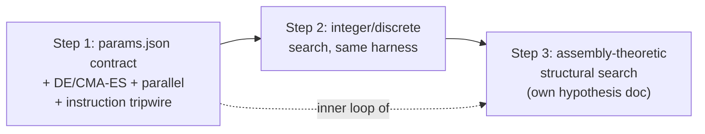
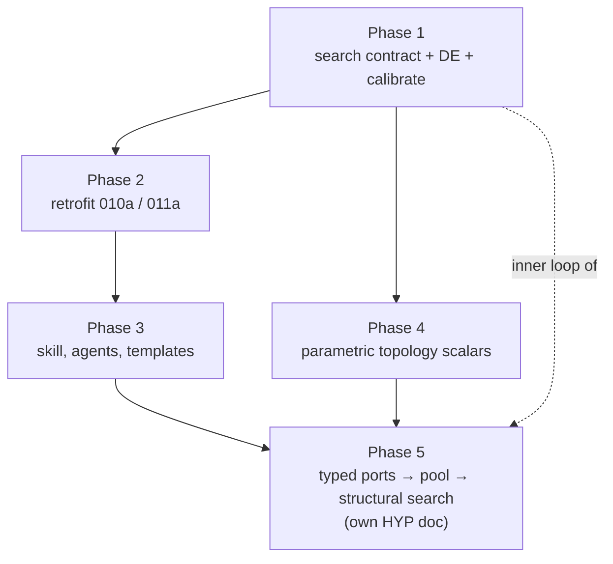

# Standard Mechanicals

Grounding first — three things in the audit's remedy list are already partially built, which changes the diagnosis:

| Remedy | Status |
| :--- | :--- |
| `tools.tune` optimizer | **Exists** — `tune.py`, scipy Nelder-Mead/Powell, exported from `tools` |
| Shared runner harness | **Exists** — `runner.rs` (IO + `SubstrateExperimentRunner` trait) |
| "Don't hand-tune" directive | **Exists** — `sci-execution-analysis.md:41-42`, Principle 6 |

So the honest framing is not "we lack the tool." It's **the tool existed, the rule existed, and the agent still hill-climbed for 45 minutes.** That failure mode should drive the plan.

---

## Part 1 — Why the existing directive failed

Principle 6 says *"Use systematic, programmatic parameter exploration… Do not tune constants through repeated prompt-driven edits."* Four reasons it didn't bind:

**1. It's a principle, not a branch.** It sits in a list of nine general responsibilities, read once at agent start. The moment it needs to fire is 40 minutes later, at `cargo test` returning `accuracy = 0.866 < 0.900`. At that instant the agent's local context is a stack trace, not a principles list. The rule has to live in the **Workflow** section as an explicit control-flow branch at the failure point, with a countable tripwire: *after the second numeric-literal edit against the same failing assertion, you are forbidden to make a third — invoke search or return `INFRASTRUCTURE_GAP`.* Countable, self-auditable, and checkable after the fact by grepping the diff for repeated edits to the same constant.

**2. It names no tool.** "Programmatic parameter exploration" is a category, not an affordance. The agent has to invent the mechanism, which is more work than guessing one more number. Every prohibition needs a named, one-line invocation next to it.

**3. There is no Rust↔Python bridge.** This is the real blocker. `optimize_parameters` takes a Python callable. The thing to optimize is a Rust binary. Nothing in the repo defines how an objective evaluation crosses that gap. The agent's path of least resistance was correct given the tooling: the tuner was unusable for the task in front of it.

**4. The deeper bug is upstream in protocol design.** The agent wrote hard numeric acceptance thresholds (`≥ 0.900`) into integration tests *before* knowing the substrate's operating regime, then searched parameters until the test passed. Mechanising that search makes it 900× faster — and 900× faster at **overfitting the acceptance criterion**. That's worse, not better, unless you fix the protocol at the same time.

So the instruction change is three-part, and spans all three `Sci:` agents:

- **Theory/Protocol** must pre-register the tunable vector, its bounds, the scalar objective, *and* the calibration/validation split before execution starts.
- **Execution** must invoke search, never hand-edit, and must report the search budget and the held-out score.
- **Curator** owns the harness as shared infrastructure.

Calibration fits parameters on one seed set; acceptance is evaluated on frozen parameters against **fresh seeds and unseen conditions**. Without that split, mechanical search is a liability.

Placement: a `mechanical-search` skill as the canonical "how," with short hard rules plus a pointer in each agent file. That mirrors how `research-lifecycle` already works.

---

## Part 2 — What's actually missing from the tooling

The gap is smaller than the audit implies. `tune.py` has five concrete deficiencies:

1. **No process bridge.** Needs a stable contract: `params.json` in → `metrics.json` out, one process invocation per evaluation. That single convention is probably 80% of the value of this whole workstream, and it's about 40 lines.
2. **Wrong algorithm class.** Nelder-Mead on a Heaviside-thresholded stochastic substrate is a bad match — the objective is piecewise-constant with cliffs, so the simplex collapses on plateaus and the `converged` flag is close to meaningless. Differential evolution or CMA-ES is the right default here.
3. **Serial.** Evaluations are embarrassingly parallel and there are 16 vCPUs sitting idle.
4. **No integer support.** Refractory ticks, evaluation windows, and track lengths are discrete. Round-and-clamp inside a continuous optimizer wastes most of the budget.
5. **No provenance artifact.** The search trace is as much a scientific result as the sweep is. If the chosen parameters can't be re-derived, the experiment isn't reproducible.

None of that is a framework. It's an afternoon of work on an existing file plus one convention.

---

## Part 3 — The assembly-theory question

This is where I'd push back on the premise, then agree with the conclusion for a different reason.

### Three distinct search spaces

| Space | Example | Right machinery |
| :--- | :--- | :--- |
| Continuous scalars | $\theta_{gate}$, $W_{inh}$, $\lambda$, $\beta_\theta$ | CMA-ES / DE |
| Discrete scalars | ring size, refractory ticks, slot count | integer-aware DE, small exhaustive grids |
| **Structure** | what graph should this circuit *be* | evolutionary / assembly-theoretic |

Conflating these is the trap. **100% of the measured Time Sink 1 was the first row.** In both 010a and 011a the agent already knew the topology it wanted — a Dyck stack, a 16-slot associative array — and burned its session on scalars. An assembly-theoretic structural search would not have saved a single minute of that milestone.

So: **do not justify the assembly framework as a fix for Time Sink 1.** If you build it for that reason, you'll spend weeks and Time Sink 1 will still be there.

### But build it anyway, for the scientific reason

The stronger argument is about what the campaign can *claim*. Right now every circuit topology is hand-designed by an LLM. The structure is a prior, not a finding. That caps the results: you can show "this hand-wired substrate implements a pushdown store," but never "this is the *minimal* structure that supports pushdown memory," or "capability X emerged from recombination of previously-discovered components without being designed in." Those are the claims the vision is actually reaching for, and they are unreachable without structural search.

That makes it a **research milestone with its own hypothesis document**, not tooling smuggled in as an efficiency fix.

### What assembly theory buys over a generic GA

A plain GA over graphs gives you soup. Assembly theory contributes a specific and, I think, genuinely well-matched selection pressure:

- A **cumulative typed component pool**, seeded from the already-verified primitives in src/substrate/primitives/ — tracks, gates, latches, memory banks.
- **Composition operations** that join typed ports, where reusing an object already in the pool is near-free while novel construction costs. That reuse asymmetry *is* the assembly index, and it's exactly what distinguishes assembly index from raw size.
- **Fitness = task performance $-\ \lambda \cdot a(\text{structure})$**, which operationalises "the cheapest structure that does the job." Far more defensible than "the structure I happened to wire."
- **The pool persists across milestones.** Every accepted experiment deposits its verified circuit as a reusable component with a known assembly index; Tier $N{+}1$ searches over Tier $N$'s deposits. This maps directly onto the complexity ladder already described in the README — it makes the *campaign itself* an assembly process, which is a much better story than a tooling upgrade.

Two design notes I'd want settled before any code:

- **Typed ports are the whole engineering cost.** Without them, mutation and crossover produce invalid graphs ~99% of the time and the search never gets off the ground. Get the type algebra right first; everything else is mechanics.
- **Track the assembly index constructively, don't compute it.** Exact assembly index on a finished graph is a minimal-construction-path problem and is expensive. If you record the construction path *as you build*, you get a valid upper bound for free. Cheap, sound, and sufficient for selection pressure.

This also argues for Rust, not Python: structural search needs $10^4$–$10^6$ evaluations.

### The dependency that makes the sequencing obvious

Structural search is **impossible** until parameter search is mechanical. Every candidate topology needs its scalars fitted before it can be scored — otherwise you're comparing a good topology with bad constants against a bad topology with lucky constants, and the search optimises noise. Parameter search is the inner loop of structural search.



So Step 1 is not a detour from the assembly framework — it's a hard prerequisite for it. That's the cleanest justification for doing the small, boring thing first.

---

## Summary of my position

1. The directive and the tool both exist; the failure was **no trigger, no named invocation, no Rust↔Python bridge**. Fix those three and Time Sink 1 largely disappears.
2. Fix the **protocol side simultaneously** — calibration/validation split and pre-registered objectives — or you'll just automate overfitting.
3. `tune.py` needs an upgrade (algorithm, parallelism, integers, provenance), not a replacement. Small.
4. The assembly-theoretic structural search is **worth building, but not for efficiency** — build it as a Tier 4+ research capability with its own hypothesis, and only after the parameter inner loop exists.
5. Ownership maps onto existing roles with no new agents: Theory/Protocol pre-registers objective and bounds, Execution invokes search, Curator owns the harness.

---

## Implementation Plan

### Decisions taken

| Question | Decision |
| :--- | :--- |
| Harness language | **Rust.** Python is curation/documentation tooling only. |
| Retrofit 010a/011a | **Yes** — as the harness validation case. |
| Assembly pool | **Persistent on-disk artifact** from day one. |
| Port typing | Typed ports accepted as the core engineering cost. |
| Assembly index | Tracked **constructively** during composition, never computed post-hoc. |
| Retrofit governance (Q1) | **Re-run and re-tag.** Immutability protects earlier steps on the path; updating the most recent steps is legitimate. |
| Objective authorship (Q2) | **Rust code**, committed before the search runs and pinned by git SHA in the protocol. |
| Dependency policy (Q3) | **Hand-roll DE.** Minimise dependencies; revisit only on demonstrated stall. |
| Discovered topology lineage (Q6) | **No separate HYP/DIAG lineage.** A discovered circuit is an artifact of the milestone that searched for it. |
| Calibration budget (Q7) | **60 s default** wall-clock cap, configurable per protocol. |
| Assembly-index selection (Q4) | **Integer-bucketed Pareto archive** — one champion per assembly index, no $\lambda$. |
| Pool admission (Q5) | **Mechanical predicate** (typed, characterised, non-redundant, earned); curator owns criteria, not entries. |
| Atoms (Q8) | **Five fundamental operations** — `Const`, `Delay`, `Sum`, `Multiply`, `Compare`. Nodes and builders are derived compositions. |
| `Multiply` arity | **Signal × signal**, not signal × parameter — keeps synaptic plasticity structurally expressible. |
| Noise | **Exogenous boundary source at $a = 0$**, not a sixth atom. The basis stays deterministic. |
| Equivalence certificate | **Statistical equivalence** over seeded runs is sufficient; bit-identical is not required. |

#### Consequence of Q1 for Phase 2

Re-running and re-tagging removes the awkward "parallel non-authoritative artifact" construction entirely. 010a and 011a get calibrated parameters, are re-executed under the standard protocol, and are re-tagged with a superseding run manifest that cites the prior tag. The retrofit becomes an ordinary experiment execution rather than a special case, and the harness is validated by the same path every future milestone will take.

The one discipline this requires: the superseding run manifest must record the prior tag and state what changed and what did not, so the path remains reconstructible.

### What the Rust decision changes

The "Rust" answer kills the most expensive part of my earlier proposal. I had assumed a subprocess bridge: `params.json` in → `metrics.json` out, one process spawn per evaluation. With the harness in Rust and the experiments in Rust, **an evaluation is a direct function call.** No spawn, no serialisation, no file I/O in the inner loop. Roughly three orders of magnitude cheaper per evaluation, which is what makes the structural search in Phase 5 feasible at all ($10^4$–$10^6$ evaluations).

JSON survives only at the boundaries, as artifacts:

- `params.json` — the **frozen output** of a calibration, read once at experiment start.
- `calibration.json` — the search provenance record.
- `pool.json` — the persistent assembly pool.

A second piece of luck: experiment configs are already serde types. [exp_2026_011a/config.rs](src/experiments/exp_2026_011a_mva_associative_retrieval/config.rs#L65) derives `Serialize, Deserialize` on `ExperimentConfig`. So a calibration result can be applied as a JSON overlay onto the existing config with near-zero new per-experiment code. That is the cheapest possible integration path and I'd build directly on it.

---

### Phase 1 — Search contract and optimizers

**Location:** `src/substrate/search/` (new module, exported via `substrate::prelude`).

#### 1.1 Search space (`search/space.rs`)

```rust
pub enum ParamKind {
    Continuous { lo: f64, hi: f64 },
    Integer    { lo: i64, hi: i64 },
    Categorical(Vec<String>),
}

pub struct ParamSpec { pub name: String, pub kind: ParamKind, pub init: Option<f64> }
pub struct SearchSpace { specs: Vec<ParamSpec> }
```

`SearchSpace` owns encode/decode between a normalised $[0,1]^n$ vector (what optimizers operate on) and a named `serde_json::Map` (what configs consume). Integer and categorical rounding happens **inside** decode, so every optimizer gets mixed-type support for free and none of them need to know about it. This is the fix for deficiency 4 in Part 2.

#### 1.2 Objective (`search/objective.rs`)

```rust
pub struct Evaluation { pub loss: f64, pub metrics: BTreeMap<String, f64> }

pub trait Objective: Sync {
    fn evaluate(&self, params: &serde_json::Value, seeds: &[u64]) -> Evaluation;
}
```

`seeds` is a parameter, not baked into the objective. That is what makes the calibration/validation split enforceable in 1.4 rather than a matter of agent discipline.

#### 1.3 Optimizers (`search/optimizer.rs`)

Ask/tell interface, because it makes batch parallelism trivial and is the natural shape for population methods:

```rust
pub trait Optimizer {
    fn ask(&mut self) -> Vec<Vec<f64>>;          // a batch of normalised candidates
    fn tell(&mut self, batch: &[(Vec<f64>, f64)]);
    fn is_done(&self) -> bool;
}
```

The driver evaluates each `ask` batch with `rayon::par_iter` — already a dependency ([Cargo.toml](Cargo.toml#L10)) — saturating all 16 vCPUs. Fixes deficiency 3.

Implementations, in order:

1. `RandomSearch` — Latin-hypercube / Sobol. The honest baseline; any claim that DE helped must beat it.
2. `DifferentialEvolution` — ~150 lines, no new dependency, naturally handles bounds and the plateau-heavy Heaviside objective that defeats Nelder-Mead. **This should be the default.**
3. `CmaEs` — deferred. Only if DE demonstrably stalls, and then via the `cmaes` crate rather than hand-rolled.

#### 1.4 Calibration driver (`search/calibrate.rs`)

```rust
pub fn calibrate(
    space: &SearchSpace,
    objective: &dyn Objective,
    opt: &mut dyn Optimizer,
    seeds: &SeedSplit,      // { calibration: Vec<u64>, validation: Vec<u64> }
    budget: Budget,         // { max_evals, max_wall_clock }
) -> Result<CalibrationReport, SearchError>;
```

`SeedSplit::new` **returns an error if the two seed sets intersect.** The overfitting guard is a type-system property, not a guideline. `CalibrationReport` carries: space definition, optimizer name and settings, budget, evaluation count, best params, calibration loss, **held-out validation loss**, and the full trace. Serialised to `calibration.json`. Fixes deficiencies 1, 2 and 5.

**Deliverable:** ~600 lines of Rust in `src/substrate/search/`, plus unit tests on analytic functions (sphere, Rastrigin, a deliberately plateaued step function) with known optima.

---

### Phase 2 — Retrofit 010a and 011a

Purpose is validation of the harness against a **known answer**, and producing a hard number for the audit follow-up.

1. Define a `SearchSpace` bracketing the hand-tuned constants in 011a — $\theta_{gate}$, $\beta_\theta$, $W_{inh}$, $\lambda$, $N_{ref}$, $T_{eval}$ — the exact six the agent hill-climbed for 45 minutes.
2. Implement `Objective` wrapping the existing trial loop. The accuracy and violation metrics already exist in the runner, so this is an adapter, not new science.
3. Run DE. Success criterion: **match or beat the hand-tuned held-out accuracy, in under 60 seconds.**
4. Repeat for 010a's pointer-advance delays and quench weights.
5. Record the comparison: evaluations/second and wall-clock against the transcript's 27 turns / 45 minutes.
6. **Re-run both experiments end to end under the calibrated parameters and re-tag** (Q1). The superseding run manifest cites the prior tag and states what changed — parameters and their derivation — and what did not: topology, protocol, acceptance criteria.

Because the retrofit re-runs rather than annotates, it exercises the exact path every future milestone will take, which is a stronger validation of the harness than a side artifact would have been.

---

### Phase 3 — Instructions, skills, templates

This is the part that actually prevents recurrence, and it is cheap.

**New skill:** `.agents/skills/mechanical-search/SKILL.md`, symlinked from `.github/skills/mechanical-search`. Note the asymmetry in this repo — `.github/skills/*` are symlinks, so skills are authored once, but `.github/agents/*.agent.md` are **real duplicate files**, so every agent edit must be mirrored by hand. The `template-agent-design` skill governs that.

Content: the calibration/validation contract, the invocation snippet, the tripwire rule, and worked examples from the Phase 2 retrofit.

**Agent edits (each in both trees):**

| Agent | Change |
| :--- | :--- |
| `sci-theory-protocol` | Protocol must emit a `SearchSpec` block: tunable vector, bounds, scalar objective, seed split. No search may run against an objective written after results are seen. |
| `sci-execution-analysis` | Move the rule out of Principle 6 into the **Workflow** section as a branch at the test-failure point. Add the countable tripwire: *two numeric-literal edits against the same failing assertion is the limit; the third is forbidden — calibrate or return `INFRASTRUCTURE_GAP`.* Name the invocation inline. |
| `sci-substrate-curator` | Owns `src/substrate/search/` and, later, pool admission. |

**Template edits:** [experiment-run-template.md](docs/templates/experiment-run-template.md) and the protocol template gain a Calibration section (search space, optimizer, budget, evaluations, calibration vs held-out scores, `calibration.json` path).

**Python:** deprecate `tools.tune` with a docstring pointer to the Rust harness. Two competing tools is worse than one. Keep `Parameter`/`TuningResult` importable so [test_tune.py](python/tests/test_tune.py) keeps passing until removal.

---

### Phase 4 — Discrete and structural groundwork

Mostly absorbed by Phase 1 (integer and categorical kinds are in `ParamKind` from the start). The remaining work is exposing *topological* scalars — ring sizes, track lengths, slot counts — as search parameters rather than compile-time constants. That requires the circuit builders to be parametric, which [primitives/memory.rs](src/substrate/primitives/memory.rs) largely already is: `build_associative_slot`, `build_readout_tree` and `build_pointer_ladder` exist and take parameters. This phase is the bridge to Phase 5 and should be done opportunistically, when a milestone needs it.

---

### Phase 5 — Assembly pool and structural search

Ships as a **research milestone with its own HYP document**, not as tooling. Gated on Phases 1–3.

#### 5.1 Typed ports (`src/substrate/assembly/port.rs`)

The whole engineering cost, so it goes first and alone. Q8 simplifies it: at atom level the value lattice is just two types.

```rust
pub enum Signal { Real, Bool }          // `Compare` is the sole Real -> Bool transition
pub enum Dir { In, Out }
pub struct Port { pub name: String, pub dir: Dir, pub signal: Signal, pub slot: SlotId }
```

A join is legal iff directions oppose and signals unify. Everything downstream depends on this relation being total and cheap — it is what keeps mutation closed over valid graphs instead of producing 99% garbage.

A second well-formedness rule arrives with Q8: **every cycle must contain at least one `Delay`**, or the semantics are undefined. Checked by cycle detection on the delay-free subgraph.

[`NetworkSubstrate::named_ports`](src/substrate/network.rs#L21) already exists as an untyped `HashMap<String, usize>`, so this enriches a real concept rather than introducing a new one.

#### 5.2 Component and constructive assembly index (`assembly/component.rs`)

```rust
pub enum Construction {
    Primitive,
    Compose { parts: Vec<ComponentId>, joins: Vec<(PortRef, PortRef)> },
}

pub struct Component {
    pub id: ComponentId,
    pub ports: Vec<Port>,
    pub construction: Construction,
    pub assembly_index: u32,   // computed at composition time, never re-derived
    pub provenance: Provenance // origin experiment, git tag, verification status
}
```

On composition: $a_{\text{new}} = 1 + \sum_{p \in \text{distinct new parts}} a_p$, where a part already resident in the pool contributes $0$. That reuse asymmetry is the entire point — it is what separates assembly index from raw node count, and computing it constructively gives a sound upper bound for free while sidestepping the minimal-construction-path search that makes exact assembly index intractable.

#### 5.3 Persistent pool (`assembly/pool.rs`)

`data/assembly/pool.json`, append-mostly, git-tracked, carrying a monotonic `pool_version` that every reported assembly index must cite.

Per Q8, **v0 is the five atoms and nothing else.** The eight verified builders already in `src/substrate/primitives/` — `build_and_gate`, `build_or_gate`, `build_inverter`, `build_resonant_ring`, `build_associative_slot`, `build_readout_tree`, `build_pointer_ladder`, `build_fan_out` — enter as *derived* entries with computed indices, alongside the intermediate tiers (`LeakyIntegrator`, `DownCounter`, `LifNode`, `Synapse`). Deriving those indices is the framework's first result and its cheapest validation.

#### 5.3a Atom-graph execution engine (`assembly/exec.rs`)

New, required by Q8. Compiles an atom graph into a flat evaluation schedule: topologically sort the delay-free subgraph, bind the `Delay` set as the state vector, emit a fixed instruction sequence once per topology rather than per tick. Standard synchronous-dataflow practice; recovers most of the interpretive overhead.

Gated on a **behavioural equivalence certificate**: the atom composition `LifNode` must be statistically equivalent to [`CircuitNode`](src/substrate/node.rs) over seeded runs — matching spike rasters within tolerance rather than bit-identically, since floating-point association order differs. Until that certificate exists, `NetworkSubstrate` remains the sole production engine and the atom layer is analysis-only.

#### 5.4 Structural search (`assembly/search.rs`)

Evolutionary loop over construction paths. Mutations: draw a component from the pool, join a compatible port pair, delete a part, duplicate-with-variation. All type-checked, so offspring are valid by construction. Fitness combines task score against assembly index — see Question 4 on whether that is a weighted scalar or a Pareto front. **Phase 1's parameter search is the inner loop:** each candidate topology gets its scalars fitted before scoring, otherwise the search optimises luck rather than structure.

---

### Sequencing and dependencies



| Phase | Scope | Risk | Gate to proceed |
| :--- | :--- | :--- | :--- |
| 1 | ~600 lines, new module | Low | Unit tests find known optima on plateaued functions |
| 2 | Adapters only, no science changed | Low | Matches hand-tuned held-out accuracy in < 60s |
| 3 | Docs and agent files | Low | Tripwire is grep-checkable against a diff |
| 4 | Opportunistic | Low | Driven by milestone need |
| 5 | Large, research-bearing | **High** | `LifNode` equivalence certificate, plus typed-port join relation proven total and cheap |

---

### Open design choices (Phase 5 only)

Phases 1–4 are fully specified. The following affect the structural search and nothing earlier.

#### Q4 — How assembly index enters selection

Structural search has two objectives in tension: task performance $f$ and assembly index $a$. Three ways to combine them.

**Option A — fixed scalar penalty.** $F = f - \lambda a$.

Two problems, the second fatal.

First, $\lambda$ has units and no principled value. $f$ is an accuracy in $[0,1]$; $a$ is an integer that might range over $1..500$. So $\lambda \approx 10^{-3}$, and the right magnitude shifts per milestone. **We would be hand-tuning a magic number in order to avoid hand-tuning magic numbers.**

Second, linear scalarisation can only ever reach solutions on the **convex hull** of the tradeoff curve. Any structure sitting in a concave region is provably unreachable for *every* value of $\lambda$. That is not a theoretical worry here: $a$ is integer-valued and capability in this substrate appears in discrete jumps — a latch either holds state or it does not — so the front will be full of plateaus and steps. Option A would silently hide exactly the minimal structures we are searching for.

**Option B — full multi-objective (NSGA-II style).** Maintain a non-dominated set over $(f, a)$, with non-dominated sorting and crowding distance for diversity.

Correct, but heavier than necessary: $O(MN^2)$ sorting per generation and a diversity mechanism to stop the population collapsing into one corner.

**Option C — integer-bucketed archive.** My recommendation, and the reason I now prefer it to Option B:

> **Because $a$ is a small non-negative integer, the Pareto front is just a lookup table indexed by $a$.**

Keep one champion per assembly-index bucket: `archive[a] = best structure with index a`. Then:

- Non-dominated sorting is unnecessary — bucketing on an integer computes the front for free.
- The archive *is* the diversity mechanism; no crowding distance needed.
- Implementation cost is close to Option A; scientific value is Option B's.
- The archive serialises directly as the result artifact.

This yields the claim the campaign actually wants: *"minimum assembly index achieving $\text{Accuracy} \ge 0.95$ on Dyck-4 is 23."* That is a capability-versus-assembly-cost curve — the assembly-theoretic statement — rather than "here is a circuit that works." Fronts overlay across milestones to show the ladder.

Two details that matter:

- The $f$ stored in the archive must be the **held-out validation score**, not the calibration score, or the archive fills with overfit champions.
- Cap $a \le a_{\max}$ per milestone to bound the archive and the search.

Final selection for downstream use is a pre-registered rule, not a judgement call: *take the minimum-$a$ entry meeting the protocol's acceptance threshold.*

#### Q5 — Pool admission

The framing I got wrong first time: this is not a hygiene question, it is a **measurement** question.

Because reuse of a pool member costs zero in the constructive index, **admitting a component makes it free forever after.** Every assembly index reported downstream is therefore a function of pool contents. Two consequences:

1. Under auto-deposit, assembly index drifts downward over campaign time and becomes a measure of history rather than of structure. Cross-milestone comparison silently breaks.
2. **This is true under any admission policy.** So regardless of Q5, `pool.json` needs a monotonic `pool_version`, and every reported assembly index must cite it. Otherwise the numbers are not comparable across time. That requirement is unconditional and I will build it either way.

Given that, the three admission options:

| Option | Mechanism | Failure mode |
| :--- | :--- | :--- |
| **A. Auto-deposit** | Every accepted experiment's circuit enters | Near-duplicates accumulate (010a's stack and 011a's array share substructure), branching factor explodes, index deflates |
| **B. Curator gate** | Curator decides admission | Subjective judgement inserted into an otherwise mechanical pipeline; bottleneck; risk of stagnation |
| **C. Mechanical predicate** | Automatic admission against committed criteria; curator owns the *criteria* and handles exceptions | Criteria need maintenance |

**I now recommend C** over my earlier lean toward B, because it keeps the pipeline mechanical — the same principle driving this whole workstream. Admit iff all four hold:

1. **Typed** — every port declares direction and signal type. Hard requirement; untyped components cannot compose.
2. **Characterised** — ships with a behavioural spec test (truth table or response specification) pinning what it does. Directly analogous to the existing integration tests.
3. **Non-redundant** — not behaviourally equivalent, under its port spec, to an existing member. The `substrate-curation` skill already mandates behavioural-equivalence checking for refactors, so this machinery is conceptually present.
4. **Earned** — either actually used by an accepted experiment, or present on the Pareto archive frontier.

The curator's role becomes criteria owner and exception handler rather than gatekeeper.

Also needed regardless: **eviction by deprecation, never deletion.** Entries carry `active | deprecated | superseded_by(id)` so history stays reconstructible.

#### Q8 — What are the atoms? (resolved: fundamental operations)

Assembly index is only defined relative to a declared set of atoms. My first two candidate sets were both wrong, and the second was wrong for an instructive reason.

**Rejected: the builders as atoms.** `build_and_gate`, `build_resonant_ring`, `build_associative_slot` at $a = 1$ each makes every index relative to an arbitrary snapshot of today's library. "Minimal" would mean "minimal given what we happened to write by September 2026."

**Also rejected: the node and edge as atoms.** Taking `CircuitNode` as atomic assumes the structure of a node. It works today and it may not work tomorrow, and more importantly it smuggles a large, unexamined design decision into position zero of the measurement scale. [node.rs](src/substrate/node.rs) and the step function in [network.rs](src/substrate/network.rs#L88-L148) show a "node" is not remotely atomic — it bundles at least eight distinct mechanisms:

weighted presynaptic summation · sign-dependent leaky decay · potential clamping · threshold comparison · reset-on-fire · refractory down-counter · rolling-rate EMA · homeostatic threshold adaptation with saturation

Declaring that composite to be an atom of cost 1 would make every downstream assembly index meaningless as a first-principles claim.

**Adopted: a minimal basis of fundamental operations.** The substrate is a discrete-time, piecewise-affine dynamical system. Such systems have a small irreducible operational basis:

| Atom | Semantics | State | Notes |
| :--- | :--- | :--- | :--- |
| `Const` | $y = c$ | no | **The only carrier of parameters** |
| `Delay` | $y_t = x_{t-1}$ | yes | **The only carrier of state** |
| `Sum` | $y = \sum_i x_i$ | no | |
| `Multiply` | $y = x_1 \cdot x_2$ | no | Both operands are signals, not constants |
| `Compare` | $y = [\,x_1 \ge x_2\,]$ | no | The only nonlinearity; $\mathbb{R} \to \mathbb{B}$ |

**Five atoms.** Each is irreducible: `Compare` is the only nonlinearity, `Delay` the only time element, `Const` the only source, and neither `Sum` nor `Multiply` is expressible in the others. Together they are complete for any discrete-time piecewise-affine system — which is exactly what this substrate is, and which is a checkable claim rather than an aesthetic preference.

Note what is **not** an atom:

- `Scale(w)` = `Multiply` + `Const`. Keeping `Multiply` binary over two *signals* rather than signal-times-parameter is what makes synaptic plasticity structurally expressible without changing the basis — a plastic weight is just a `Delay`-based accumulator feeding the second operand. Several DIAG documents already flag STDP as the natural next step, so this matters.
- `Gate(c, a, b)` = $c \cdot a + (1 - c) \cdot b$ = `Multiply` + `Sum` + `Const`. Derivable, therefore excluded.
- `Negate`, `Subtract`, `Min`, `Max`, `Clamp` — all derivable.
- **`Noise` is deliberately excluded.** Stochasticity enters only at the boundary, as an exogenous source alongside sensory input and clock. This keeps the basis deterministic and matches how the repo already treats noise (a `noise_rate` config and `is_noisy_node` flags — injected, not structural). Boundary sources carry $a = 0$: they are environment, not structure.

##### The consequence that makes this clean

Parameters live **only** in `Const` atoms. So:

> **Structure is what the assembly index counts. Parameters are what the Phase 1 calibrator fits.**

The two search layers separate perfectly, with no overlap and no double-counting. This also resolves a problem I had not yet flagged: if parameter values were part of structural identity, `Scale(0.73)` and `Scale(0.74)` would be distinct atoms, the atom set would be infinite, and assembly index would be undefined. Confining parameters to `Const` slots that the calibrator fills makes the basis finite and the index well-posed.

##### What this upturns, and what it does not

**It does not destabilise Phases 1–4.** `NetworkSubstrate` remains the production engine for hand-specified experiments. The atom layer is required only for structural search and index accounting. The bridge is a **behavioural equivalence certificate**: prove the atom-graph composition named `LifNode` is bit-identical to `CircuitNode` under the same inputs and seeds. The `substrate-curation` skill already mandates equivalence checking for refactors, so the machinery is conceptually present. Existing experiments keep their fast path, and the decomposition becomes a *certified re-description* rather than a rewrite.

**It does change four things in Phase 5:**

1. **A second execution engine is needed.** Evaluating an atom graph is not stepping nodes. Naive interpretation would run perhaps $5$–$20\times$ slower. The fix is standard synchronous-dataflow practice: topologically sort the delay-free subgraph, treat the `Delay` set as the state vector, and emit a flat evaluation schedule once per topology. This recovers most of the speed and is bounded engineering, not research — and it is precisely why the harness is in Rust.
2. **A well-formedness rule appears.** Every cycle in the atom graph must contain at least one `Delay`, or the semantics are undefined. Cheap to check by cycle detection on the delay-free subgraph, and it is a *useful* constraint: it prunes a large class of nonsense from the mutation operators for free.
3. **Port types get simpler, not harder.** My earlier `Signal::{Spike, Level, Token, Clock}` was pitched at node level. At atom level the lattice is just `Real` and `Bool`, with `Compare` the sole $\mathbb{R} \to \mathbb{B}$ transition. A smaller, more principled type algebra — which is good news, since typed ports were identified as the main engineering cost.
4. **The pool becomes a genuine hierarchy.** Pool v0 is five axioms. Everything else is derived with an honest, computed index:

   ```text
   atoms      Const · Delay · Sum · Multiply · Compare
     └─ tier 1   Scale · Gate · Accumulator · LeakyIntegrator · DownCounter
          └─ tier 2   LifNode · Synapse · RefractoryBlock
               └─ tier 3   AndGate · OrGate · Inverter · TransmissionTrack · ResonantRing
                    └─ tier 4   AssociativeSlot · ReadoutTree · PointerLadder
   ```

   Every existing builder in [primitives/](src/substrate/primitives/mod.rs) lands somewhere in that lattice with a derived cost. **Computing those indices is itself the first result of the framework** — and a cheap, early validation. My rough expectation is that `LifNode` will have an index well below its atom *count*, because motifs like `LeakyIntegrator` recur (membrane potential and threshold adaptation are the same shape). If that holds, the framework immediately says something true and non-obvious about the substrate we already built.

##### Does the larger search space become a problem?

Atom-level structural search has a vastly larger space than node-level. But the pool *is* the mitigation, and this is the assembly-theory thesis rather than a workaround: search draws from accumulated feedstock, so it never has to rediscover a LIF node from first principles. Higher complexity is reachable precisely because prior assembly made it cheap. Q8's answer therefore strengthens the scientific narrative instead of threatening it.

##### Rigour note for the HYP document

Classical assembly index counts distinct sub-objects on the minimal construction path of a *single* object, so reuse within an object is free. Charging zero for *cross-object* pool reuse is the **feedstock variant** — assembly index given an available inventory. Defensible and standard, but it must be stated explicitly rather than assumed, because the two give different numbers.

---

### Remaining decisions needed

All resolved. See the decisions table above.

---

## Work Packages

The plan is restructured below into narrow, independently verifiable packages for delegation. Each package states its own acceptance criterion so it can be dispatched to a specialist agent and validated without re-reading the whole plan. **This document is the specification** — packages reference sections rather than restating them.

| WP | Deliverable | Depends on | Agent | Acceptance criterion |
| :--- | :--- | :--- | :--- | :--- |
| **WP-1** | `src/substrate/search/` — space, objective, optimizers, calibration driver (§Phase 1) | — | `Code: SWE` | `cargo test` green; DE recovers known optima on sphere, Rastrigin and a plateaued step function; `SeedSplit::new` rejects intersecting sets; `cargo fmt --check` and `clippy` clean |
| **WP-2** | `.agents/skills/mechanical-search/SKILL.md` + `.github/skills/` symlink | — | `Code: SWE` | Skill present and symlinked; markdownlint clean |
| **WP-3** | Directive updates to `sci-theory-protocol`, `sci-execution-analysis`, `sci-substrate-curator` in **both** `.agents/agents/` and `.github/agents/` | WP-2 | `Code: SWE` | Tripwire appears in the Workflow section, not the principles list; the two trees are content-identical |
| **WP-4** | Calibration sections in the protocol and run-manifest templates | WP-2 | `Code: SWE` | markdownlint clean; fields cover search space, optimizer, budget, evaluations, calibration vs held-out score, artifact path |
| **WP-5** | EXP-2026-011a calibration, re-run, re-tag (§Phase 2) | WP-1 | `Sci: Execution & Analysis` | Held-out accuracy ≥ hand-tuned baseline; calibration completes < 60 s; superseding manifest cites the prior tag |
| **WP-6** | EXP-2026-010a calibration, re-run, re-tag | WP-1, WP-5 | `Sci: Execution & Analysis` | As WP-5 |
| **WP-7** | Deprecate `tools.tune` with a pointer to the Rust harness | WP-1 | `Code: SWE` | `test_tune.py` still passes; deprecation notice present |

Phase 5 packages (typed ports, atom-graph execution engine, pool, structural search) are deferred until WP-1 through WP-7 are complete and the equivalence-certificate approach has been validated on `LifNode`.

### WP-5a result — harness validated, and a scientific finding

The 011a calibration ran. Against the hand-tuned baseline on identical held-out seeds:

| | Held-out loss | Clean acc. | Noisy acc. ($\epsilon = 0.05$) |
| :--- | ---: | ---: | ---: |
| Differential evolution | **0.0000** | 1.0000 | **1.0000** |
| Random search (equal budget) | 0.0547 | — | — |
| Hand-tuned baseline | 0.0234 | 1.0000 | 0.9766 |

DE strictly beat the hand-tuned parameters and beat random search at equal evaluation count, so the optimizer rather than sampling density is doing the work. **The optimum was reached at evaluation 48, roughly 3.8 seconds in** — against 27 `cargo test` cycles over ~45 minutes in the audited session. That is the ~700$\times$ figure the workstream was built to deliver, now measured rather than projected.

Three issues surfaced, in increasing order of importance.

**1. Budget overrun (harness defect, trivial).** DE has no stop-on-target rule and the budget is checked before each batch, so the run consumed the full 60 s and overran by 1.19 s on the final in-flight batch. Two small fixes: an optional target-loss early stop, and a batch-aware budget check.

**2. Objective saturates (protocol defect).** At 128 sequences per noise level the loss bottoms out at exactly zero and stops discriminating, so DE had no gradient after evaluation 48 and the reported optimum is one of many zero-loss points. The workload must be hard enough that the objective retains resolution across the whole search.

**3. The calibrated optimum may invalidate the experiment's mechanism claim.** This is the important one.

The search drove `beta_theta` from $0.05$ to $0.001$ — effectively switching **off** somatic threshold adaptation — and still achieved perfect held-out accuracy, apparently by shortening the readout window `t_readout` from 16 to 7 instead. But threshold adaptation is precisely the mechanism EXP-2026-011a claims confers noise shielding; the `AblationFixedTheta` condition ($\beta_\theta = 0$) exists to demonstrate that claim.

The cause is an **under-specified objective**, and it is exactly the failure mode identified in Part 1: the original test asserted both *"active must be accurate"* and *"active must beat fixed-theta"*, but the objective encoded only the first. Given only that term, the optimizer correctly found a region where the claimed mechanism is unnecessary.

The lesson generalises and belongs in the protocol directive: **a pre-registered objective must encode every acceptance assertion, including comparative and ordering constraints between conditions.** An objective that omits an ablation ordering will be exploited by any competent optimizer.

This is also the strongest available argument for the workstream. Hand-tuning reached a parameter set where the mechanism *appeared* necessary. Mechanical search found, in under four seconds, that it may not be. That question was invisible for as long as a human-paced loop was doing the searching.

**WP-5b (re-run and re-tag) is blocked** pending a protocol-level decision on issue 3.

### WP-5c result — the objective was fixed, and the mechanism claim did not survive intact

The objective was completed to encode all eight acceptance assertions, including the ordering terms WP-5a omitted, using smooth hinge penalties $h(x, m) = \max(0, (m - x)/m)$ so orderings carry gradient rather than a pass/fail cliff. Workload rose from 256 to 1216 trials per evaluation, which removed the saturation: best loss anywhere is now $0.0391$, never exactly zero.

Re-calibration recovered `beta_theta` from $0.001$ to $0.0153$, and the WP-5a parameters were confirmed to fail the shielding ordering outright ($\text{term} \approx 1.05$). So WP-5a was indeed an artifact of the incomplete objective, exactly as the completeness rule predicts.

Then the $\beta_\theta$ sweep answered the scientific question, and the answer is not the comfortable one.

**At the shipped hand-tuned parameters the ablated mechanism does nothing.** Sweeping $\beta_\theta$ across $[0, 0.20]$ — a 200$\times$ range including zero — moves the shielding margin not at all:

| $\beta_\theta$ at hand-tuned params | Active acc. $\epsilon{=}0.05$ | Fixed-$\theta$ acc. | Margin |
| ---: | ---: | ---: | ---: |
| all 12 values, $0 \to 0.20$ | 0.9792 | 0.9792 | **0.0000** |

Not a digit moves. Active and fixed-$\theta$ produce identical predictions on all 192 held-out sequences per noise level.

`test_noise_percolation_shielding` nonetheless passes today, because the `AblationFixedTheta` condition is not a single-variable ablation. Inspection of [config.rs](src/experiments/exp_2026_011a_mva_associative_retrieval/config.rs#L108-L131) shows it differs from the active condition in **four** parameters simultaneously:

| Field | Active | `AblationFixedTheta` | Intended? |
| :--- | ---: | ---: | :--- |
| `beta_theta` | 0.05 | 0.00 | yes — the ablation |
| `theta_floor` | 1.02 | 0.50 | no |
| `theta_gate_init` | 1.10 | 1.00 | no |
| `w_fwd` / `w_fb` | 1.10 | 1.00 | no |

**The published demonstration of noise shielding rests on a compound between-condition confound, not on the mechanism it names.** Equalising `theta_gate_init` alone collapses the margin from $0.1333$ to $0.0000$.

Two secondary findings:

- **At the newly calibrated optimum the mechanism is real but binary.** Margin $0.0000$ at $\beta_\theta = 0$, then $0.281$ at $\beta_\theta = 0.001$ and perfectly flat to $0.20$. Adaptation on-versus-off matters enormously; the *rate* is irrelevant across 200$\times$. Any claim resting on the magnitude of the adaptation rate is unsupported.
- **`t_readout` is not the alternative explanation.** The margin holds at $0.25$–$0.35$ across `t_readout` $\in [6, 32]$. It governs clean accuracy, not shielding.

Also recorded honestly: at a 144-evaluation budget, DE and random search are indistinguishable on held-out loss (both $0.0625$) and both are *worse* held-out than the 24-evaluation result. On this objective the extra budget bought overfitting. **DE's advantage over random search is not demonstrated here** — it was demonstrated under the WP-5a objective, which we now know was the wrong objective.

#### Consequence

WP-5b is not merely blocked, it is **the wrong action**. Re-running and re-tagging with calibrated parameters would publish a cleaner number over an uncorrected methodological defect. The required next steps are a diagnostic record of the confound and a protocol amendment deciding whether the ablation should be single-variable — an orchestrator and theory decision, not an execution one.

#### Two things

WP-6 just got more interesting. 010a was built by the same agent, in the same session, by the same hand-tuning loop. Its ablations are worth checking for the same compound-difference pattern before calibrating anything. I'd make that the first question of WP-6 rather than a footnote.

And a governance question. Should the mechanical-search skill require that every ablation condition be verified as single-variable — a diffable check that conditions differ in exactly the field they claim to ablate? That would have caught this at authoring time, cheaply and mechanically. It feels like the same class of fix as the objective-completeness rule.

### Orchestration protocol

To keep expensive reasoning out of mechanical work:

1. Each package is dispatched with a scope, the plan section that specifies it, and its acceptance criterion — nothing more.
2. Subagents do not redesign. A package that cannot be completed as specified is returned as a gap report, not worked around.
3. Validation after each package is `cargo fmt --check`, `cargo clippy`, `cargo test` for Rust, and markdownlint for documentation.
4. Packages are dispatched one at a time so that a failure surfaces before dependent work begins.
