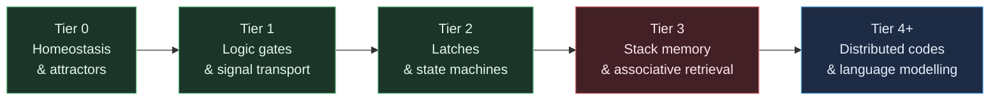
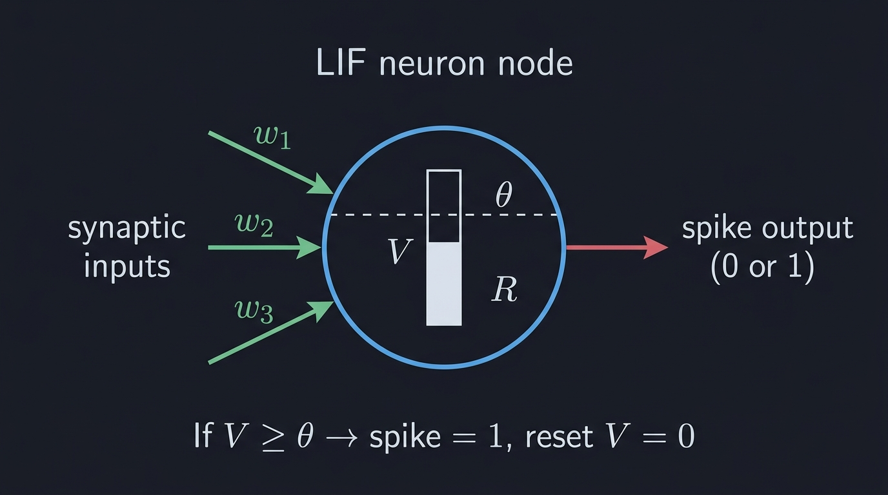
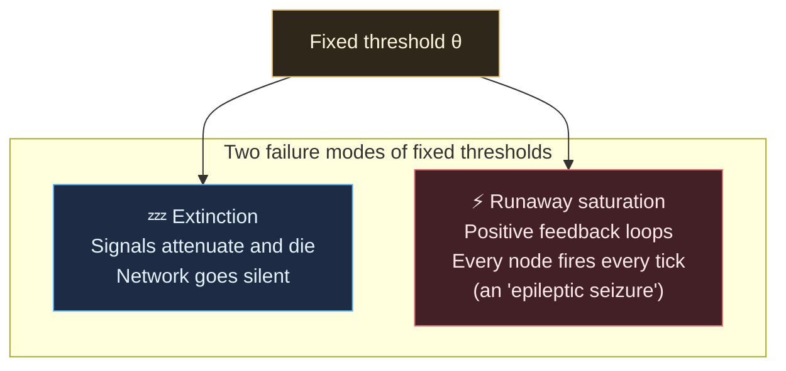
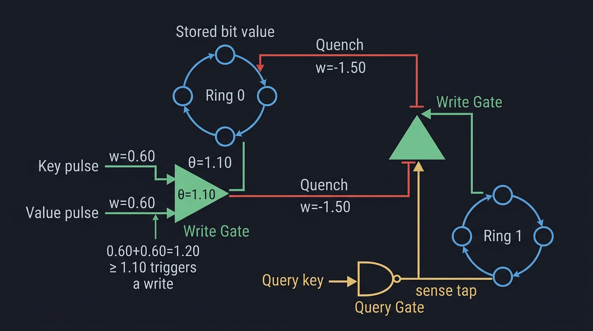
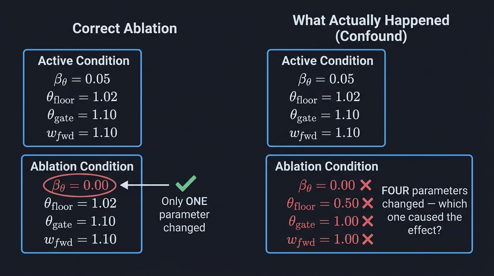
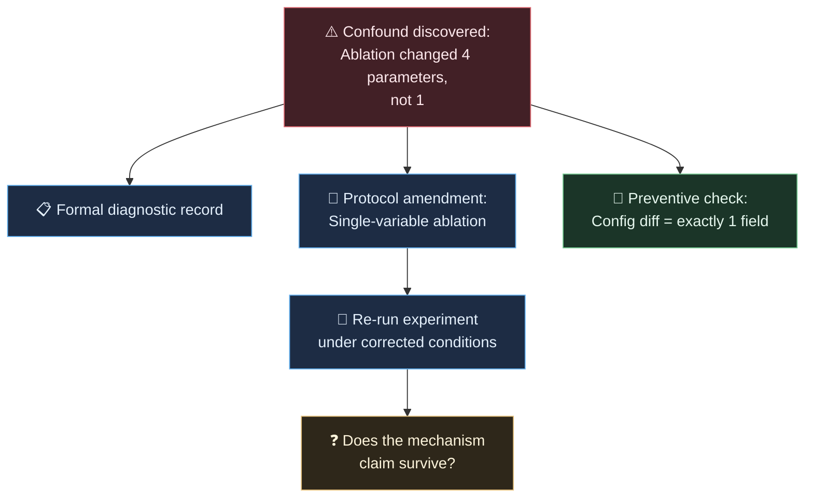

# Understanding the 011a Confound — From the Ground Up

> An educational walkthrough for readers unfamiliar with this repository.
> Assumes roughly undergraduate-level background in computing and science.

---

## Table of Contents

1. [What is this project trying to do?](#1-what-is-this-project-trying-to-do)
2. [What is a spiking neural network?](#2-what-is-a-spiking-neural-network)
3. [The node: a leaky integrate-and-fire cell](#3-the-node-a-leaky-integrate-and-fire-cell)
4. [How nodes talk to each other](#4-how-nodes-talk-to-each-other)
5. [Threshold adaptation: the homeostatic thermostat](#5-threshold-adaptation-the-homeostatic-thermostat)
6. [The capability ladder: proving computation emerges](#6-the-capability-ladder-proving-computation-emerges)
7. [Experiment 011a: building a dictionary from spikes](#7-experiment-011a-building-a-dictionary-from-spikes)
8. [What is an ablation study?](#8-what-is-an-ablation-study)
9. [The confound: what actually went wrong](#9-the-confound-what-actually-went-wrong)
10. [Why this matters](#10-why-this-matters)

---

## 1. What is this project trying to do?

Modern AI (large language models, image generators) runs on GPUs doing enormous matrix multiplications. It works, but it's wildly energy-hungry, it separates "training" from "inference" into two rigid phases, and it has no ability to repair or reorganise itself on the fly.

This project asks: **can you build a computing substrate that works more like biological tissue?** Specifically:

- **Decentralised.** No central processor, no shared memory bus. Every unit only talks to its immediate neighbours.
- **Self-organising.** The system adjusts its own internal parameters continuously, rather than being trained once and frozen.
- **Thermodynamically bounded.** Inspired by real neurons, which compute on roughly 20 watts for an entire brain.

The substrate is a **cellular automaton** — a grid (or graph) of simple cells, each following local rules, whose collective behaviour produces computation. The scientific question is: **how much computational capability can emerge from purely local, simple dynamics?**

To answer that, the project climbs a **capability ladder**, proving increasingly complex abilities at each tier:

Experiment 011a sits at **Tier 3** — associative key-value retrieval. That's roughly analogous to a dictionary or hash map, but built entirely from spiking cells with no central memory.

---

## 2. What is a spiking neural network?

Conventional artificial neural networks pass continuous floating-point numbers between layers. A spiking neural network (SNN) is different: its units communicate with **binary pulses** — either you fire (1) or you don't (0), like a neuron in your brain either sends an action potential or stays silent.

This is a closer model of biological computation, and it has an important property: **information is carried by the timing and pattern of spikes, not by continuous values.** A spike costs energy to send; silence is free. That makes SNNs naturally energy-efficient.

In this project, the SNN operates in **discrete time steps** (clock ticks). At every tick, every node in the network decides: fire or stay silent. Then time advances and we do it again.

---

## 3. The node: a leaky integrate-and-fire cell

Each node in the network is a **Leaky Integrate-and-Fire (LIF)** cell. Think of it as a tiny bucket that collects water (electrical charge) and tips over when full.

Here's how it works at each time step:

### Step 1: Collect inputs

The node receives weighted signals from its neighbours. If neighbour $j$ fired at the previous tick with weight $w_j$, that contributes $w_j \times 1.0$ to the current node's input. All inputs sum together:

$$I = \sum_{j \in \text{neighbours}} w_j \cdot \text{spike}_j$$

### Step 2: Update the membrane potential

The node has an internal voltage $V$ (the "membrane potential"). Each tick it:

- **Leaks** — some of the stored charge dissipates: $V \leftarrow (1 - \lambda) \cdot V$, where $\lambda$ is the leak rate
- **Integrates** — adds the new input: $V \leftarrow V + I$

The leak is what makes it *leaky*: if no input arrives, the voltage gradually decays back to zero. This prevents stale charge from lingering forever.

### Step 3: Threshold comparison

The node has a firing threshold $\theta$. If $V \ge \theta$, the node **fires a spike**:

- Output spike = 1
- Voltage resets to 0
- A **refractory counter** activates: the node is locked out for $N_\text{ref}$ ticks (typically 2), during which it cannot fire no matter what input arrives

If $V < \theta$, the node stays silent (output = 0) and the voltage is preserved for the next tick.

### The refractory period: a one-way valve

The refractory period is critically important. After firing, the node goes silent for 2 ticks. In a ring of connected nodes (a loop), this prevents a spike from bouncing backwards the way it came — it can only travel forward around the ring. This turns recurrent loops into **one-way transmission lines**, which is what makes stable memory possible. Without it, signals would reflect back and forth destructively.

### In code

The full dynamics are implemented in [`network.rs`](file:///workspaces/ca-experiment/src/substrate/network.rs) (the step function) and the state variables live in [`node.rs`](file:///workspaces/ca-experiment/src/substrate/node.rs) (the `CircuitNode` struct).

---

## 4. How nodes talk to each other

Nodes are connected by **directed, weighted edges** — like one-way wires with an amplification or attenuation factor. An edge from node $A$ to node $B$ with weight $w = 0.6$ means: "when $A$ fires, $B$ receives 0.6 units of current on the next tick."

Key properties:

- **Positive weights** are excitatory — they push the receiving node toward firing.
- **Negative weights** are inhibitory — they suppress the receiving node, preventing it from firing. This is how the network implements "quenching" (erasing stored data).
- **Bounded fan-in** — each node has at most 4 incoming connections ($k_\text{in} \le 4$). This enforces locality: no node has a global view of the network.
- **Unit delay** — signals take exactly one tick to travel along an edge. This strict causality is what makes the simulation deterministic and physically plausible.

A useful building block from these connections is the **coincidence gate**: set the threshold to 1.10 and connect two inputs with weight 0.60 each. Neither input alone ($0.60 < 1.10$) can fire the gate, but both together ($0.60 + 0.60 = 1.20 \ge 1.10$) can. This is how the substrate implements AND-like logic purely from weighted summation and thresholding.

---

## 5. Threshold adaptation: the homeostatic thermostat

Here's a problem with fixed thresholds: in a recurrent network with feedback loops, things can go wrong in two directions:

**Threshold adaptation** is the solution. The threshold $\theta$ adjusts itself based on how often the node has been firing:

- **Fire too often?** $\theta$ increases slightly — the node becomes harder to activate, dampening the runaway.
- **Been silent too long?** $\theta$ decreases slightly — the node becomes more sensitive, preventing extinction.

The rate of this adjustment is controlled by a parameter called $\beta_\theta$ (beta-theta). A larger $\beta_\theta$ means faster adaptation; $\beta_\theta = 0$ means the threshold is permanently fixed.

The threshold is also bounded: it can never drop below $\theta_\text{floor}$ (preventing spurious spontaneous firing) or rise above $\theta_\text{max}$ (preventing permanent silencing).

This is a form of **homeostasis** — the same principle that keeps your body temperature at 37°C regardless of whether you're in a sauna or a snowstorm. In the substrate, it keeps the firing rate in a healthy operating band.

### Why this matters for noise resilience

The hypothesis was that threshold adaptation should help the network **resist noise**. When noisy random currents are injected into the network (simulating imperfect physical hardware), nodes that receive extra stimulation from noise would raise their thresholds, making them less likely to fire from noise alone. Meanwhile, the signal-carrying nodes would maintain their thresholds at appropriate levels. The adaptive threshold would act as an automatic noise filter.

**That was the claim. Whether it's actually true is what Challenge 1 is about.**

---

## 6. The capability ladder: proving computation emerges

The project works by building increasingly complex computational circuits from these simple spiking nodes and then **empirically proving** they work. Each tier on the capability ladder is a separate experiment:

| Tier | Capability | What it proves | Experiment |
| :--- | :--- | :--- | :--- |
| 0 | Homeostasis | The network reaches a stable firing equilibrium | 001a–005a |
| 1 | Logic gates, signal transport | AND, OR, NOT gates work; signals travel reliably down chains | 006a–007a |
| 2 | Latches, state machines | The network can hold persistent state (memory) and recognise regular languages | 008a–009a |
| **3** | **Stack memory, associative retrieval** | **The network can store and retrieve key-value pairs** | **010a–011a** |
| 4+ | Distributed codes, language modelling | The network can do statistical sequence prediction | Future work |

Each experiment includes:

- A **formal hypothesis** with mathematical predictions
- An **experimental protocol** specifying exact conditions, seeds, and measurements
- **Ablation conditions** — systematic removals of mechanisms to prove they're necessary
- A **run manifest** — a frozen record of exactly what was run

---

## 7. Experiment 011a: building a dictionary from spikes

This is where things get concrete. Experiment 011a asks:

> **Can 272 spiking nodes, with no central memory and no shared bus, perform associative key-value storage and retrieval?**

That's essentially asking: can you build a dictionary (like Python's `dict` or a hash map) from nothing but simple cells that can fire or stay silent?

### The task

The network is presented with a streaming sequence of tokens:

1. **16 key-value pairs** arrive in random order. Each key is one of 16 addresses ($K_0$ through $K_{15}$), and each value is a binary bit (0 or 1).
2. The stream is padded with **distractor tokens** — irrelevant filler that should be ignored.
3. At the end, a **query** arrives: "What value was stored at key $K_j$?"
4. The network must output the correct bit within a readout window of 16 ticks.

This is sometimes called a **"needle in a haystack"** test — the network has to store all 16 bindings, ignore hundreds of distractors, and recall the right one on demand.

### How it's built

The 272-node circuit uses several building blocks from the [primitives library](file:///workspaces/ca-experiment/src/substrate/primitives/):

**Memory slots (128 nodes).** Each of the 16 slots has two 4-node recurrent rings — one for "bit 0" and one for "bit 1". A circulating pulse in a ring represents a stored bit. The refractory shielding (§3) ensures pulses circulate in one direction without destructive reflection.

**Write gates (64 nodes).** Writing requires the **coincidence** of a key pulse and a value pulse at the same slot. Each contributes weight 0.60, and the gate threshold is 1.10. Only when both arrive simultaneously ($0.60 + 0.60 = 1.20 \ge 1.10$) does the write succeed. A single input alone ($0.60 < 1.10$) cannot trigger a write — this is how the network implements content-addressable writing without a CPU.

**Mutual exclusion / quench (included in write gates).** When a "write 1" gate fires, it simultaneously sends a strong inhibitory signal ($w = -1.50$) to the opposing "bit 0" ring, silencing any pulse that was circulating there. This ensures each slot stores exactly one bit, not a superposition.

**Query gates (32 nodes).** A query works similarly to a write, but non-destructively. The query key pulse and a "sense tap" from the active ring both contribute 0.60, triggering the gate only if that slot's ring is active.

**Readout trees (10 nodes).** The 16 query gate outputs are pooled through a fan-in reduction tree (respecting the 4-input limit per node) down to two terminal output ports: $v_\text{out,0}$ and $v_\text{out,1}$.

### The experimental conditions

The experiment doesn't just run the full system — it runs four conditions:

| Condition | What it tests | Key change |
| :--- | :--- | :--- |
| **Active** | The full system | Everything enabled |
| **Baseline Unindexed** | Is key-addressing necessary? | All writes forced to slot 0 (single-slot latch) |
| **Ablation: No Refractory** | Are refractory periods necessary? | $N_\text{ref} = 0$ (spikes can bounce backwards) |
| **Ablation: Fixed Theta** | Is threshold adaptation necessary for noise resilience? | $\beta_\theta = 0$ (no adaptation) |

The last condition — **Ablation: Fixed Theta** — is where the problem lives.

---

## 8. What is an ablation study?

An **ablation study** is a standard scientific technique borrowed from neuroscience (where it literally means removing a brain region to see what stops working). In computational experiments, it means:

> **Disable exactly one mechanism and see if performance degrades. If it does, that mechanism was necessary. If it doesn't, it wasn't.**

The key word is **exactly one**. The entire logic of an ablation depends on changing a single variable while holding everything else constant. This is the principle of **controlled experimentation** that you learn in introductory science courses:

- **Independent variable:** the one thing you change (e.g., set $\beta_\theta = 0$)
- **Dependent variable:** what you measure (e.g., accuracy under noise)
- **Controlled variables:** everything else, which must remain identical

If you change multiple things at once, you have a **confound** — you can't tell which change caused the observed effect. This is exactly what happened.

---

## 9. The confound: what actually went wrong

### The claim

The experiment claimed: *"Dynamic threshold adaptation ($\beta_\theta > 0$) is necessary for noise resilience. When we disable it ($\beta_\theta = 0$), accuracy under noise drops significantly."*

The test `test_noise_percolation_shielding` verified this by running the Active condition and the Fixed Theta ablation under noise ($\epsilon = 0.05$) and asserting that Active outperforms Fixed Theta.

**The test passed.** So the claim appeared to be supported.

### What the automated calibration revealed

When a mechanical parameter search tool (a Differential Evolution optimizer) was pointed at this experiment, it found something unexpected: it could achieve **perfect accuracy** even with $\beta_\theta$ driven down to 0.001 — essentially disabling the mechanism the experiment claimed was essential.

This triggered a closer look at the ablation condition's configuration.

### The four-parameter confound

The `AblationFixedTheta` condition was **supposed** to change only $\beta_\theta$ (the adaptation rate). But in the actual code ([config.rs](file:///workspaces/ca-experiment/src/experiments/exp_2026_011a_mva_associative_retrieval/config.rs), lines 108–131), it changed **four parameters simultaneously**:

| Parameter | Active | Ablation | Intended? |
| :--- | :--- | :--- | :--- |
| $\beta_\theta$ (adaptation rate) | 0.05 | 0.00 | ✅ Yes — this is the ablation |
| $\theta_\text{floor}$ (minimum threshold) | 1.02 | 0.50 | ❌ No |
| $\theta_\text{gate\_init}$ (initial gate threshold) | 1.10 | 1.00 | ❌ No |
| $w_\text{fwd}$ / $w_\text{fb}$ (ring weights) | 1.10 | 1.00 | ❌ No |

### The controlled experiment that proved it

To isolate the actual cause, a proper single-variable sweep was run: $\beta_\theta$ was swept across a 200× range ($0.00$ to $0.20$) while **holding all other parameters fixed** at their Active values.

The result was devastating:

| $\beta_\theta$ | Active accuracy ($\epsilon = 0.05$) | Fixed-$\theta$ accuracy | Margin |
| :--- | :--- | :--- | :--- |
| All 12 values, 0.00 → 0.20 | 0.9792 | 0.9792 | **0.0000** |

**The margin was zero across the entire range.** Active and Fixed-$\theta$ produced bit-identical predictions. Sweeping $\beta_\theta$ from zero to twenty times its default value changed absolutely nothing about noise resilience.

Then the individual confounding parameters were tested. **Equalising $\theta_\text{gate\_init}$ alone** (setting the ablation's gate threshold to 1.10 to match Active, while still keeping $\beta_\theta = 0$) collapsed the reported shielding margin from 0.1333 to 0.0000.

In other words: the test was passing because of the **gate threshold difference**, not because of threshold adaptation.

### Why the gate threshold matters

This is physically intuitive once you see it. Recall the coincidence gate mechanism:

- **Active condition:** gate threshold = 1.10, input weights = 0.60 each. The margin above threshold is $1.20 - 1.10 = 0.10$. Noise has to overcome a 0.10 margin to cause a false activation.
- **Ablation condition:** gate threshold = 1.00, input weights = 1.00 each. The margin above threshold is $2.00 - 1.00 = 1.00$. But a *single* input ($1.00 \ge 1.00$) can now fire the gate alone — the coincidence requirement is destroyed.

The ablation didn't just disable threshold adaptation — it **also made the write gates easier to trigger spuriously**, which is a completely different mechanism. The degraded noise performance was caused by broken gating, not by missing adaptation.

---

## 10. Why this matters

### For the science

The experiment's **retrieval capability** is unaffected — the substrate genuinely can store and retrieve 16 key-value pairs from 272 spiking nodes with no central memory. Gates 1–3, 5, and 6 all still pass cleanly. That result is real and stands.

What does **not** stand is the **mechanistic explanation** for noise resilience. The claim "threshold adaptation provides noise shielding" was unsupported by the ablation because the ablation was confounded. At the experiment's operating point, adaptation appears to be inert — on vs off matters, but the rate ($\beta_\theta$) doesn't.

### For the process

This confound was **invisible for months** while the experiment was run, analysed, and documented by hand. It was found in **under 4 seconds** by an automated parameter search tool that happened to explore a region of parameter space the human/agent hand-tuning process never visited.

That's the real lesson: **manual tuning finds *a* working point and stops; mechanical search explores the *space* and sometimes finds that the working point's explanation is wrong.** The tool that was built to save time on parameter tuning accidentally became a scientific instrument for detecting methodological defects.

### What happens next

The confound must be resolved before the experiment can be re-run and re-published:

1. **Diagnostic record.** The confound is itself a finding and needs to be formally documented.
2. **Protocol amendment.** A decision must be made: should the ablation be corrected to a proper single-variable comparison? If so, does the mechanism claim survive under corrected conditions?
3. **Preventive tooling.** A mechanical check — "diff the ablation config against the active config and assert exactly one field changed" — would have caught this at authoring time. Whether to mandate that check for all future experiments is an open governance question.

---

*This document is a companion to [standard-mechanicals.md](standard-mechanicals.md) and the [remaining challenges summary](file:///home/vscode/.gemini/antigravity-cli/brain/404437e5-7af6-4510-a885-c543010e4f51/remaining-challenges.md). For the full technical discussion, design decisions, and implementation plan, see the source document.*
