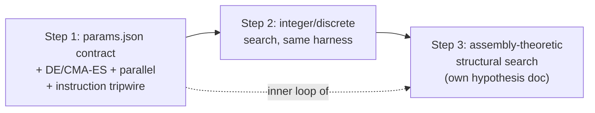

# Standard Mechanicals

Grounding first — three things in the audit's remedy list are already partially built, which changes the diagnosis:

| Remedy | Status |
| :--- | :--- |
| `tools.tune` optimizer | **Exists** — `tune.py`, scipy Nelder-Mead/Powell, exported from `tools` |
| Shared runner harness | **Exists** — `runner.rs` (IO + `SubstrateExperimentRunner` trait) |
| "Don't hand-tune" directive | **Exists** — `sci-execution-analysis.md:41-42`, Principle 6 |

So the honest framing is not "we lack the tool." It's **the tool existed, the rule existed, and the agent still hill-climbed for 45 minutes.** That failure mode should drive the plan.

---

## Part 1 — Why the existing directive failed

Principle 6 says *"Use systematic, programmatic parameter exploration… Do not tune constants through repeated prompt-driven edits."* Four reasons it didn't bind:

**1. It's a principle, not a branch.** It sits in a list of nine general responsibilities, read once at agent start. The moment it needs to fire is 40 minutes later, at `cargo test` returning `accuracy = 0.866 < 0.900`. At that instant the agent's local context is a stack trace, not a principles list. The rule has to live in the **Workflow** section as an explicit control-flow branch at the failure point, with a countable tripwire: *after the second numeric-literal edit against the same failing assertion, you are forbidden to make a third — invoke search or return `INFRASTRUCTURE_GAP`.* Countable, self-auditable, and checkable after the fact by grepping the diff for repeated edits to the same constant.

**2. It names no tool.** "Programmatic parameter exploration" is a category, not an affordance. The agent has to invent the mechanism, which is more work than guessing one more number. Every prohibition needs a named, one-line invocation next to it.

**3. There is no Rust↔Python bridge.** This is the real blocker. `optimize_parameters` takes a Python callable. The thing to optimize is a Rust binary. Nothing in the repo defines how an objective evaluation crosses that gap. The agent's path of least resistance was correct given the tooling: the tuner was unusable for the task in front of it.

**4. The deeper bug is upstream in protocol design.** The agent wrote hard numeric acceptance thresholds (`≥ 0.900`) into integration tests *before* knowing the substrate's operating regime, then searched parameters until the test passed. Mechanising that search makes it 900× faster — and 900× faster at **overfitting the acceptance criterion**. That's worse, not better, unless you fix the protocol at the same time.

So the instruction change is three-part, and spans all three `Sci:` agents:

- **Theory/Protocol** must pre-register the tunable vector, its bounds, the scalar objective, *and* the calibration/validation split before execution starts.
- **Execution** must invoke search, never hand-edit, and must report the search budget and the held-out score.
- **Curator** owns the harness as shared infrastructure.

Calibration fits parameters on one seed set; acceptance is evaluated on frozen parameters against **fresh seeds and unseen conditions**. Without that split, mechanical search is a liability.

Placement: a `mechanical-search` skill as the canonical "how," with short hard rules plus a pointer in each agent file. That mirrors how `research-lifecycle` already works.

---

## Part 2 — What's actually missing from the tooling

The gap is smaller than the audit implies. `tune.py` has five concrete deficiencies:

1. **No process bridge.** Needs a stable contract: `params.json` in → `metrics.json` out, one process invocation per evaluation. That single convention is probably 80% of the value of this whole workstream, and it's about 40 lines.
2. **Wrong algorithm class.** Nelder-Mead on a Heaviside-thresholded stochastic substrate is a bad match — the objective is piecewise-constant with cliffs, so the simplex collapses on plateaus and the `converged` flag is close to meaningless. Differential evolution or CMA-ES is the right default here.
3. **Serial.** Evaluations are embarrassingly parallel and there are 16 vCPUs sitting idle.
4. **No integer support.** Refractory ticks, evaluation windows, and track lengths are discrete. Round-and-clamp inside a continuous optimizer wastes most of the budget.
5. **No provenance artifact.** The search trace is as much a scientific result as the sweep is. If the chosen parameters can't be re-derived, the experiment isn't reproducible.

None of that is a framework. It's an afternoon of work on an existing file plus one convention.

---

## Part 3 — The assembly-theory question

This is where I'd push back on the premise, then agree with the conclusion for a different reason.

### Three distinct search spaces

| Space | Example | Right machinery |
| :--- | :--- | :--- |
| Continuous scalars | $\theta_{gate}$, $W_{inh}$, $\lambda$, $\beta_\theta$ | CMA-ES / DE |
| Discrete scalars | ring size, refractory ticks, slot count | integer-aware DE, small exhaustive grids |
| **Structure** | what graph should this circuit *be* | evolutionary / assembly-theoretic |

Conflating these is the trap. **100% of the measured Time Sink 1 was the first row.** In both 010a and 011a the agent already knew the topology it wanted — a Dyck stack, a 16-slot associative array — and burned its session on scalars. An assembly-theoretic structural search would not have saved a single minute of that milestone.

So: **do not justify the assembly framework as a fix for Time Sink 1.** If you build it for that reason, you'll spend weeks and Time Sink 1 will still be there.

### But build it anyway, for the scientific reason

The stronger argument is about what the campaign can *claim*. Right now every circuit topology is hand-designed by an LLM. The structure is a prior, not a finding. That caps the results: you can show "this hand-wired substrate implements a pushdown store," but never "this is the *minimal* structure that supports pushdown memory," or "capability X emerged from recombination of previously-discovered components without being designed in." Those are the claims the vision is actually reaching for, and they are unreachable without structural search.

That makes it a **research milestone with its own hypothesis document**, not tooling smuggled in as an efficiency fix.

### What assembly theory buys over a generic GA

A plain GA over graphs gives you soup. Assembly theory contributes a specific and, I think, genuinely well-matched selection pressure:

- A **cumulative typed component pool**, seeded from the already-verified primitives in src/substrate/primitives/ — tracks, gates, latches, memory banks.
- **Composition operations** that join typed ports, where reusing an object already in the pool is near-free while novel construction costs. That reuse asymmetry *is* the assembly index, and it's exactly what distinguishes assembly index from raw size.
- **Fitness = task performance $-\ \lambda \cdot a(\text{structure})$**, which operationalises "the cheapest structure that does the job." Far more defensible than "the structure I happened to wire."
- **The pool persists across milestones.** Every accepted experiment deposits its verified circuit as a reusable component with a known assembly index; Tier $N{+}1$ searches over Tier $N$'s deposits. This maps directly onto the complexity ladder already described in the README — it makes the *campaign itself* an assembly process, which is a much better story than a tooling upgrade.

Two design notes I'd want settled before any code:

- **Typed ports are the whole engineering cost.** Without them, mutation and crossover produce invalid graphs ~99% of the time and the search never gets off the ground. Get the type algebra right first; everything else is mechanics.
- **Track the assembly index constructively, don't compute it.** Exact assembly index on a finished graph is a minimal-construction-path problem and is expensive. If you record the construction path *as you build*, you get a valid upper bound for free. Cheap, sound, and sufficient for selection pressure.

This also argues for Rust, not Python: structural search needs $10^4$–$10^6$ evaluations.

### The dependency that makes the sequencing obvious

Structural search is **impossible** until parameter search is mechanical. Every candidate topology needs its scalars fitted before it can be scored — otherwise you're comparing a good topology with bad constants against a bad topology with lucky constants, and the search optimises noise. Parameter search is the inner loop of structural search.

So Step 1 is not a detour from the assembly framework — it's a hard prerequisite for it. That's the cleanest justification for doing the small, boring thing first.

---

## Summary of my position

1. The directive and the tool both exist; the failure was **no trigger, no named invocation, no Rust↔Python bridge**. Fix those three and Time Sink 1 largely disappears.
2. Fix the **protocol side simultaneously** — calibration/validation split and pre-registered objectives — or you'll just automate overfitting.
3. `tune.py` needs an upgrade (algorithm, parallelism, integers, provenance), not a replacement. Small.
4. The assembly-theoretic structural search is **worth building, but not for efficiency** — build it as a Tier 4+ research capability with its own hypothesis, and only after the parameter inner loop exists.
5. Ownership maps onto existing roles with no new agents: Theory/Protocol pre-registers objective and bounds, Execution invokes search, Curator owns the harness.

Open questions I'd want your call on before drafting a plan: whether the search harness lives in Rust or stays Python-driving-Rust; whether Step 1 gets retrofitted to 010a/011a as a validation case or only applied forward; and whether the assembly pool should be a persistent on-disk artifact from day one or start in-memory per-experiment.
